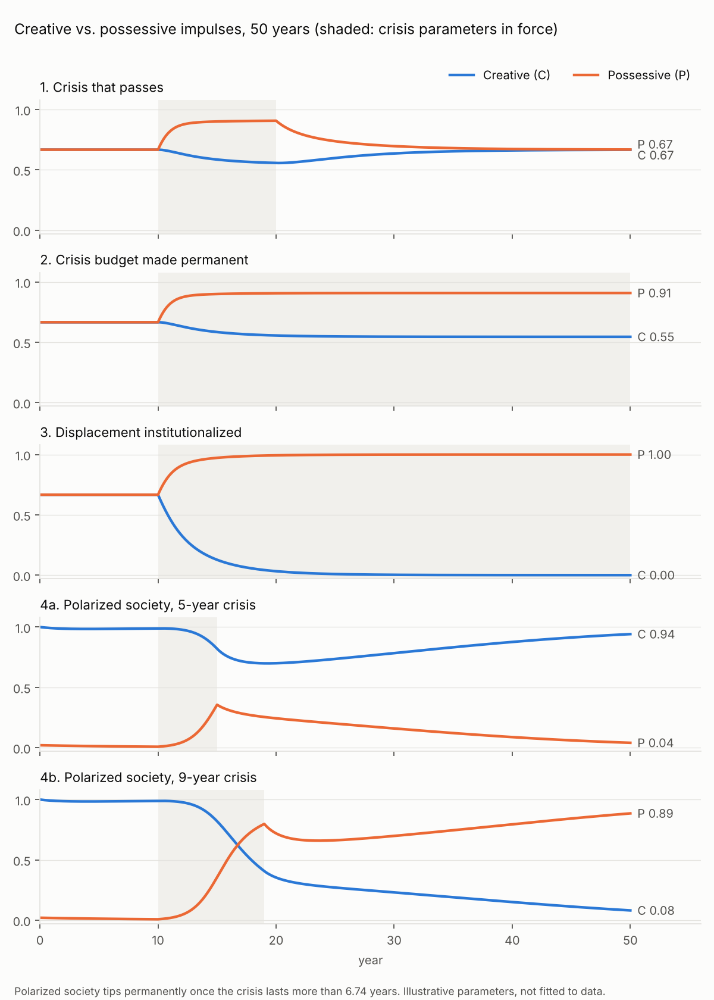

# Creative vs. possessive impulses: a competition model

Bertrand Russell's *Principles of Social Reconstruction* (1916) divides human impulses
into creative ones (making things whose use takes nothing from anyone else) and
possessive ones (acquiring or defending things others then cannot have). This
directory models the two as competing quantities with a Lotka-Volterra competition
system:

```
dC/dt = r_c·C·(1 − C) − α·P·C
dP/dt = r_p·P·(1 − P) − β·C·P
```

| symbol | meaning |
|---|---|
| C | creative impulse, 0..1 |
| P | possessive impulse, 0..1 |
| r_c, r_p | intrinsic growth rates, per year |
| α | choking factor: how strongly possessive spending displaces creative spending |
| β | resistance factor: how strongly a creative, educated public pushes back on militarism |

Each variable is a fraction of its own saturation level, not a share of one budget, so
C + P can exceed 1. All parameters are illustrative; nothing is fitted to data.

```bash
python experiments/russell_impulses/model.py
```

```bash
python -m pytest experiments/russell_impulses
```

`model.py` needs NumPy (matplotlib for the figure). It writes one CSV per scenario
(yearly C, P and the parameters in force), `summary.txt` and `trajectories.png` to
`results/`. Integration is fourth-order Runge-Kutta with a 0.01-year step; halving the
step changes no yearly value by more than 1e-8.

## What decides the long-run outcome

Write a = α/r_c and b = β/r_p. Linearizing at the two one-impulse states gives two
invasion conditions:

* C can grow back into a purely possessive society (C≈0, P=1) iff **α < r_c**.
* P can grow into a purely creative society (C=1, P≈0) iff **β < r_p**.

| α < r_c | β < r_p | outcome |
|---|---|---|
| yes | yes | stable coexistence at C\* = (1−a)/(1−ab), P\* = (1−b)/(1−ab) |
| no | yes | possessive excludes creative |
| yes | no | creative excludes possessive |
| no | no | bistable: whichever impulse dominates now stays dominant |

Two consequences follow directly:

1. **Raising r_p alone never eliminates C.** r_p appears only in the second condition.
   With α < r_c, as r_p grows without bound b → 0 and C\* falls toward 1 − α/r_c, not to
   zero. With the baseline values below that floor is 0.5.
2. **Eliminating C requires α > r_c**: possessive spending must displace creative
   spending faster than creative activity regenerates. Near C = 0 the creative impulse
   then shrinks at rate α − r_c per year.

β is the model's place for Russell's own remedy (education and culture as a check on
militarism): raising β above r_p makes the purely creative society resistant to
invasion. A crisis that raises r_p above β removes that protection.

## Scenarios (50 years, crisis from year 10)

Baseline: r_c = r_p = 0.5, α = β = 0.25, starting at the balanced equilibrium
C = P = 2/3. Scenario 4 uses a polarized society (α = β = 0.6, both above the growth
rates), which is bistable, so a balanced state is not an equilibrium there; it starts
creative-dominant with a 0.02 residue of possessive spending.

| scenario | change | C / P at year 0 | 15 | 20 | 30 | 50 |
|---|---|---|---|---|---|---|
| 1. Crisis that passes | r_p 0.5 → 1.5 for years 10–20 | 0.667 / 0.667 | 0.585 / 0.901 | 0.557 / 0.907 | 0.636 / 0.696 | 0.666 / 0.668 |
| 2. Crisis budget made permanent | r_p 0.5 → 1.5 from year 10 | 0.667 / 0.667 | 0.585 / 0.901 | 0.557 / 0.907 | 0.546 / 0.909 | 0.545 / 0.909 |
| 3. Displacement institutionalized | as 2, and α 0.25 → 0.75 | 0.667 / 0.667 | 0.127 / 0.973 | 0.032 / 0.993 | 0.003 / 0.999 | 0.000 / 1.000 |
| 4a. Polarized, 5-year crisis | r_p = 1.5 for years 10–15 | 1.000 / 0.020 | 0.821 / 0.356 | 0.700 / 0.243 | 0.784 / 0.159 | 0.942 / 0.040 |
| 4b. Polarized, 9-year crisis | r_p = 1.5 for years 10–19 | 1.000 / 0.020 | 0.821 / 0.356 | 0.353 / 0.720 | 0.230 / 0.699 | 0.081 / 0.885 |



* **1** C dips 17% (minimum 0.556, just after year 20) and recovers once the crisis ends.
* **2** A permanent war budget settles at a new coexistence point, C = 6/11 ≈ 0.545,
  P = 10/11 ≈ 0.909. Creative spending is lower but stable.
* **3** With α > r_c, creative spending falls to 0.127 within five years and below 0.01
  by year 24.6; it shrinks at 0.25 per year near zero (half-life about 2.8 years).
* **4** In the polarized society the outcome depends on crisis length only. A crisis
  longer than **6.74 years** (`critical_crisis_length()`, accurate to about 0.01 year)
  pushes the state across the boundary between the two basins, and creative spending
  keeps declining after the crisis is over: from 0.353 at year 20 to 0.081 at year 50,
  shrinking at 0.1 per year near zero (half-life about 7 years). A 5-year crisis
  leaves the same society recovering.

## Measuring C and P

The proxies map onto the UN Classification of the Functions of Government (COFOG),
which OECD, Eurostat and the IMF use for government spending by function:

| impulse | proxy | COFOG |
|---|---|---|
| C | recreation, culture and religion | 08 |
| C | tertiary education | 09.4 |
| C | environmental protection | 05 |
| C | foreign economic aid | 01.2 |
| P | defence | 02 |
| P | police services, law courts, prisons | 03.1, 03.3, 03.4 |
| P | border security | no separate code; split between 02 and 03 |
| P | corporate bailouts | no function code; mostly recorded as financial transactions, partly 04 (economic affairs) |

Fitting the model to a country would need a series for each proxy, a normalization
from spending share to the 0..1 scale (for example, share divided by the highest share
observed across countries), and a least-squares fit of r_c, r_p, α and β. That has not
been done, so the scenarios illustrate mechanisms and do not reproduce any country's
history.

## Limits

* C and P are continuous, so C never reaches exactly zero and a collapsed creative
  sector always regrows once α drops back below r_c. A minimum viable size (Allee
  effect) would be needed to model permanent loss.
* There is no shared budget constraint; each impulse saturates separately.
* Parameters switch instantly and stay constant within each regime.
